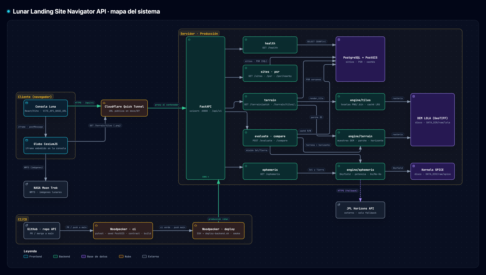
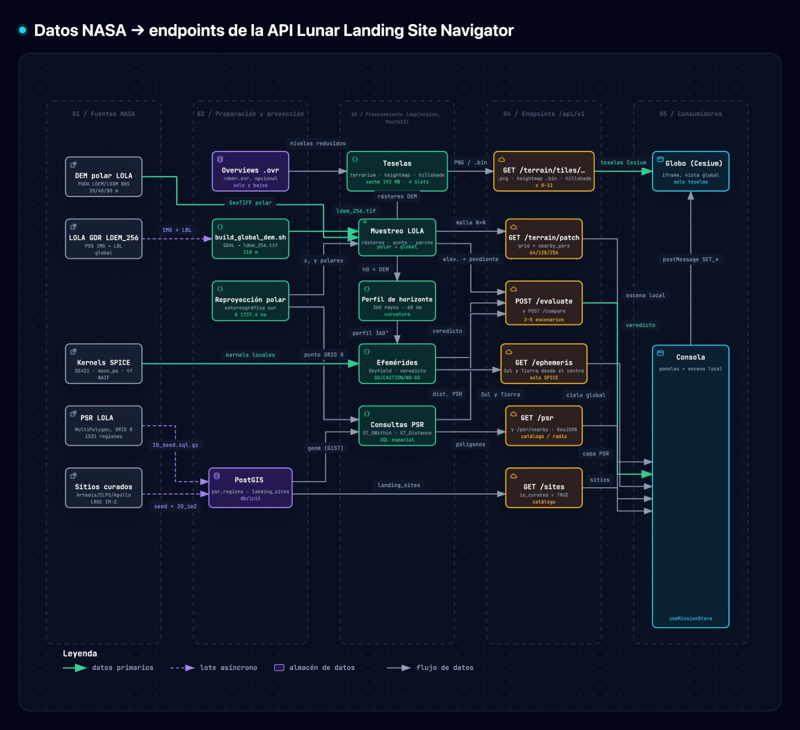

# Lunar Landing Site Navigator API

Backend for the NASA Space Apps 2026 Lunar Landing Site Navigator. It evaluates and compares lunar landing sites, with a focus on the south pole, from real NASA data:

- **Terrain:** LOLA DEMs give elevation, slope and a 360° local horizon that accounts for lunar curvature.
- **Sun and Earth:** SPICE ephemerides (Skyfield) give where the Sun and the Earth are seen from the site, with JPL Horizons and an analytical model as fallbacks.
- **Verdict:** from those, solar power potential, direct-to-Earth (DTE) communication windows and a GO / CAUTION / NO-GO verdict with its reasons.
- **Globe:** the same data feeds a 3D globe, with terrain tiles of the whole Moon and the permanently shadowed regions (PSR).



## Contents

- [System overview](#system-overview)
- [From NASA data to endpoints](#from-nasa-data-to-endpoints)
- [Endpoints](#endpoints)
- [Terrain tiles for the globe](#terrain-tiles-for-the-globe)
- [Contract and errors](#contract-and-errors)
- [Code layout](#code-layout)
- [Database](#database)
- [Configuration](#configuration)
- [Development](#development)
- [Deploy](#deploy)
- [Diagrams](#diagrams)

## System overview

The system map above shows every piece:

- **Clients (browser).** The console (React/Vite) calls the API through `VITE_API_BASE_URL`. It embeds the CesiumJS globe in an iframe and talks to it with `postMessage`. The globe reads imagery from NASA Moon Trek and terrain tiles from this API.
- **Public access.** A Cloudflare Quick Tunnel publishes the API container. The public URL lives only in the handoff repo (`docs/07`), never in this code: it changes when the tunnel restarts.
- **API.** FastAPI (uvicorn on port 8000, prefix `/api/v1`, CORS `*`) with seven routers: `health`, `sites`, `psr`, `terrain`, `evaluate`, `compare` and `ephemeris`.
- **Engine (`app/engine/`).**
  - `terrain`: DEM sampling, terrain patches and the horizon.
  - `tiles`: terrain tiles with an LRU cache.
  - `ephemeris`: Sun and Earth, power and the verdict.
- **Data.**
  - PostgreSQL + PostGIS: sites, PSRs and the computation caches.
  - LOLA DEMs (GeoTIFF) in `DATA_DIR/raw/lola`.
  - SPICE kernels in `DATA_DIR/raw/spice`.
  - JPL Horizons is the external fallback when the kernels are missing.
- **CI/CD.** A PR runs Woodpecker `ci`: pytest, seeded PostGIS, contract gate and build. A merge to `main` deploys to production, followed by smoke tests ([Deploy](#deploy)).

## From NASA data to endpoints



| NASA source | Preparation | Used by |
|---|---|---|
| LOLA polar DEMs (PGDA `LDEM_80S`, 20/40/80 m) | GeoTIFF in the south polar stereographic CRS (R = 1,737.4 km), optional `.ovr` overviews | `/terrain/patch`, `/evaluate`, `/compare`, tiles |
| LOLA GDR global DEM (`LDEM_256`, PDS IMG + LBL) | `scripts/build_global_dem.sh` (GDAL) builds `ldem_256.tif` (118 m); `ldem_64.tif` (474 m) as an alternative | Everywhere outside the polar DEMs |
| SPICE kernels (DE421, `moon_pa`, frames) | Read with Skyfield | `/evaluate`, `/compare`, `/ephemeris` |
| LOLA PSRs (1,531 `MultiPolygon`, SRID 0) | `db/init/10_seed.sql.gz` | `/psr`, `/psr/nearby`, distance to the nearest PSR |
| Curated sites (Artemis III, CLPS, Apollo; IM-2 at its LROC target) | Seed plus `db/init/20_im2_lroc_site.sql` | `/sites` |

**Coordinates.**
- Polar coordinates use the LOLA south polar stereographic CRS: `x = ρ·sin λ`, `y = ρ·cos λ`.
- 3D vectors use the viewer frame `[+X East, +Y Up, −Z North]`.

## Endpoints

All of them are under `/api/v1`. The interactive docs are at `/docs` (Swagger UI) and `/redoc`, and the schema at `/openapi.json`.

| Method and path | What it returns |
|---|---|
| `GET /health` | API, datasets (LOLA, SPICE) and database status. |
| `GET /sites` | Curated landing sites from PostGIS: 10 south pole Artemis III / CLPS sites plus Apollo 11, 15 and 17. |
| `GET /terrain/patch` | Elevation and slope grid (64×64, 128×128 or 256×256) anywhere on the Moon (`lat` −90..90), with nearby PSRs. |
| `POST /evaluate` | One site and mission window: 360° horizon profile, Sun and Earth visibility, power, timeline, GO / CAUTION / NO-GO with `checks` and `reasons`, 3D lighting vectors. |
| `POST /compare` | 2 to 5 scenarios side by side, with no duplicates (`include_timeline: true` adds each timeline). |
| `GET /psr/nearby` | GeoJSON boundaries of the PSRs around a point. |
| `GET /psr` | Every PSR once, paginated (`offset`, `limit` ≤ 500) and simplified (`simplify_m`, default 500 m), with a label point in polar metres and lat/lon. For whole-pole views such as the globe. |
| `GET /ephemeris?utc=` | Sun and Earth direction, sub-point and distance from the Moon's center in `MOON_ME_DE421`. SPICE only: `503` without kernels. |
| `GET /terrain/tiles/{z}/{row}/{col}.png` | Terrarium elevation tiles of the whole Moon (`z` 0–10). |
| `GET /terrain/tiles/heightmap/{z}/{row}/{col}.bin` | 65×65 `float32` vertex grid for Cesium heightmap terrain (`z` 0–12). |
| `GET /terrain/tiles/hillshade/{z}/{row}/{col}.png` | 8-bit gray relief shading (`z` 0–10). |

**Mission windows (`/evaluate`, `/compare`).**
- `start_utc` is ISO-8601 UTC between 1900 and 2050, which is the SPICE coverage.
- `duration_days` goes up to 366, with a default of 14.
- `step_minutes` goes from 5 to 1440, with a default of 60 in `/evaluate` and 120 in `/compare`.

**Caching.** Successful `GET`s of sites, terrain, PSRs and ephemeris carry `Cache-Control: public, max-age=3600`. `/health` and errors never do.

## Terrain tiles for the globe

The tiles answer handoff `P-008` (decision D-016) and follow the Moon Trek / Cesium geographic scheme: level 0 is 2×1, row 0 is north. They cover the whole Moon so the globe uses a single terrain source.

- **Elevation (`.png`).**
  - Format: 256×256 Terrarium, `elevation_m = R*256 + G + B/256 - 32768`, in 1/256 m steps, relative to the 1,737,400 m sphere like `/terrain/patch`.
  - Why not 16-bit PNG: browsers read PNGs through an 8-bit canvas.
- **Heightmap (`.bin`, v1.5).**
  - Format: the same terrain as a 65×65 little-endian `float32` grid. It includes the tile edges (row 0 = north) and is quantized to 1/256 m.
  - Ready for Cesium's heightmap terrain without resampling. Neighbouring tiles share bit-identical edges.
  - Gzipped when the client accepts it: about 8–12 KB instead of 90–160 KB for a Terrarium tile.
- **Hillshade (`.png`, v1.5).**
  - Format: `round(255 * cos(incidence))` of a distant light, without cast shadows.
  - Slopes are central differences on the DEM's own grid (polar stereographic with its scale factor, or latitude/longitude), read around each pixel, so tiles have no seams.
  - Query parameters:
    - `light_lon` and `light_lat`: where the light is overhead. The default is 135° E, 22° S, the globe's light.
    - `exaggeration`: default 1.
    - `fade_start_lat` and `fade_end_lat` (optional): return a gray + alpha PNG that fades in with latitude.
- **Sources.**
  - Polar DEMs: where they have data, the tiles read the one that fits the sample spacing. That is 20 m from `z` 10, 40 m at `z` 9 and 80 m below.
  - Global DEM: elsewhere, the finest one available, `ldem_256` (118 m) or `ldem_64` (474 m).
  - Low zooms: the DEMs are read decimated by a power of two, over blocks aligned to the raster origin, so neighbouring tiles share their edges. The global DEM wraps at ±180°.
  - Overviews: if a DEM has external overviews (`<dem>.ovr`, for example `ldem_256.tif.ovr`), GDAL reads the low zoom levels from them, and a `z` 0 tile goes from seconds to milliseconds. Adding, replacing or removing an `.ovr` reopens the DEM and changes the tile ETags. Only the tiles use overviews: `/terrain/patch` and `/evaluate` read the DEMs at full resolution.
- **Rendering.**
  - Up to `TILE_RENDER_CONCURRENCY` tiles render at once. The rest wait, and identical requests in flight share one render.
  - Rendered tiles stay in an in-process cache of `TILE_CACHE_MAX_MB`, with heightmaps already gzipped.
- **Headers.**
  - `X-Terrain-Source` and `X-Terrain-Resolution-M`: the DEM actually read and its spacing. Both are exposed to browsers through CORS.
  - `ETag`: changes when a DEM file is replaced. `If-None-Match` answers `304`.
  - `Cache-Control: public, max-age=3600`.
  - `503 ERR_TERRAIN_UNAVAILABLE` if the DEMs do not cover the tile.

## Contract and errors

The contract the frontends rely on lives in the handoff repo: `contracts/lunar-landing-api-contract.md`, `contracts/openapi.json` and `docs/12`. The copy of the contract in this repo (`lunar-landing-api-contract.md`) is the original v1.0.

Every change since v1.0 is additive: no field was removed or renamed.

- `site.checks` in `/evaluate` and `/compare` gives the verdict as codes (`SLOPE_*`, `SUN_*`, `DTE_*`), with level (`ok` / `caution` / `nogo`), value, threshold and an English `message`. `reasons` keeps the Spanish sentences.
- `/compare` accepts `include_timeline: true`.
- `/terrain/patch` gains `grid.source` (`lola_polar` / `lola_global` / `synthetic`) and `grid.native_resolution_m`. Elevations are rounded to 0.1 m and slopes to 0.01°, about a 3× smaller payload.
- `Cache-Control` on the reference data `GET`s.
- Later versions:
  - v1.2 adds `/psr` and `/ephemeris`.
  - v1.3 adds the terrain tiles.
  - v1.4 adds the Sun and Earth rise times and the initial visibility to the evaluation summary.
  - v1.5 raises tiles to `z` 10 and adds `X-Terrain-Resolution-M`, `/terrain/tiles/heightmap` and `/terrain/tiles/hillshade`.

Every error has the same shape (`ErrorResponse`):

```json
{
  "error": { "code": "ERR_INVALID_COORDINATES", "message": "...", "details": { "field": "lat", "allowed_range": [-90.0, 90.0] } },
  "detail": "..."
}
```

| Code | HTTP | When |
|---|---|---|
| `ERR_INVALID_PAYLOAD` | 400 / 422 | Invalid JSON, a missing body or a field that fails validation |
| `ERR_INVALID_COORDINATES` | 422 | `lat` outside −90..90 or `lon` outside −180..360 |
| `ERR_DATE_OUT_OF_RANGE` | 422 | `start_utc` outside 1900–2050 |
| `ERR_SCENARIO_LIMIT_EXCEEDED` | 422 | `/compare` with fewer than 2 or more than 5 scenarios |
| `ERR_DUPLICATE_SCENARIOS` | 422 | Repeated scenarios in `/compare` |
| `ERR_NOT_FOUND` | 404 | Unknown route or resource |
| `ERR_TERRAIN_UNAVAILABLE` | 503 | The LOLA DEMs are not available, or do not cover the request |
| `ERR_UPSTREAM_SERVICE` | 503 | Database, SPICE kernels or Horizons unavailable |

## Code layout

```
app/
  main.py            FastAPI app, CORS, Cache-Control, ErrorResponse handlers (ERR_*), routers
  models.py          Pydantic v2 request/response schemas
  db.py              PostGIS access (psycopg pool): sites, PSRs, horizon and ephemeris caches
  routers/           one module per endpoint; _common.py runs the evaluation with the caches
  engine/
    terrain.py       LOLA DEMs (polar 20/40/80 m, global ldem_256 / ldem_64), patches, 360° horizon raycasting
    tiles.py         globe tiles: elevation, heightmap and hillshade, cache and concurrency
    ephemeris.py     SPICE via Skyfield (Horizons and analytical fallbacks), power, GO/CAUTION/NO-GO verdict
    coordinates.py   lat/lon ↔ south polar stereographic, 3D vectors
db/                  PostGIS seed for local development (db/README.md)
scripts/             contract_check.py, smoke.sh, build_global_dem.sh
tests/               pytest (API, engine, tiles)
docs/                DEPLOY.md and the diagrams
.woodpecker/         CI and deploy pipelines
```

## Database

PostgreSQL 16 + PostGIS. The tables have no foreign keys: sites and PSRs relate only by distance (`ST_Distance` / `ST_DWithin` in polar metres).

| Table | Contents | Rows in the seed |
|---|---|---|
| `landing_sites` | Curated sites with LOLA elevation, slope and `nearest_psr_km` | 13 |
| `psr_regions` | LOLA permanently shadowed regions (`MultiPolygon`, SRID 0) | 1,531 |
| `horizon_profiles` | Horizon cache, filled at runtime | 0 |
| `ephemeris_cache` | Ephemeris cache, filled at runtime | 0 |

How to load and reload it locally: [`db/README.md`](db/README.md).

## Configuration

| Variable | Purpose |
|---|---|
| `DATABASE_URL` | PostgreSQL + PostGIS connection string. Without it the API still starts: `/health` reports the database as disconnected and DB-backed endpoints answer `503`. |
| `DATA_DIR` | Root of the NASA datasets (default `/data`): `raw/lola/`, `raw/lola_global/`, `raw/spice/`. Without them the engine uses synthetic terrain and JPL Horizons / analytical ephemerides. That is fine for development, not for real results. |
| `TILE_CACHE_MAX_MB` | Size of the in-process terrain tile cache, per process (default `192`). A south pole globe session needs about 100 MB. |
| `TILE_RENDER_CONCURRENCY` | Terrain tiles rendered at the same time per process (default `4`). Rendering is CPU work: a higher value only adds memory and contention. |
| `WEB_CONCURRENCY` | Uvicorn worker processes (default `1`). Each one loads its own DEM handles and caches. The desktop server uses `2` (`docs/DEPLOY.md`). |

The Docker image also sets `GDAL_CACHEMAX=256` (MB). Without it, GDAL's block cache takes 5% of the host RAM.

## Development

Requirements: Python 3.12+ and Docker, for the local PostGIS seed.

```bash
python3 -m venv .venv
source .venv/bin/activate
pip install -r requirements.txt
docker compose -f docker-compose.dev.yml up -d   # PostGIS on 127.0.0.1:5432, seeded from db/init
cp .env.example .env                              # then export it: set -a; . ./.env; set +a
uvicorn app.main:app --reload --port 8000         # docs at http://localhost:8000/docs
```

Tests:

```bash
pytest                              # no database or datasets needed
python scripts/contract_check.py    # contract gate, needs DATABASE_URL (seed database)
```

Tests that need the real NASA datasets are skipped unless the datasets are present in `DATA_DIR`.

## Deploy

There is a single environment, production (handoff decision D-017).

```
PR ─────────────► ci: pytest · seeded PostGIS · contract gate (blocking) · docker build ──► check ci/woodpecker/pr/ci
merge to main ──► ci ──► deploy: production ──► smoke tests + public health
```

`main` is protected: a PR can merge only with the `ci/woodpecker/pr/ci` check green. A Woodpecker deployment of an older `main` pipeline to `production` works as a rollback. Details: [`docs/DEPLOY.md`](docs/DEPLOY.md).

## Diagrams

`docs/diagramas/` holds four interactive diagrams. Each HTML is self-contained, with light and dark themes, zoom and PNG / SVG export, and links every node to the code. Its JSON source sits next to it. GitHub does not render the HTML files: download one and open it in a browser.

| Diagram | Shows |
|---|---|
| [`arquitectura`](docs/diagramas/arquitectura.html) | The system map above: clients, tunnel, routers, engine, data and CI/CD |
| [`evaluate-secuencia`](docs/diagramas/evaluate-secuencia.html) | The `POST /evaluate` sequence, with its caches, fallbacks and `ERR_*` branches |
| [`datos-nasa`](docs/diagramas/datos-nasa.html) | NASA sources → preparation → processing → endpoints → consumers (the second image above) |
| [`postgis-erd`](docs/diagramas/postgis-erd.html) | The four PostGIS tables with their SQL types |

They were generated with [Archify](https://github.com/tt-a1i/archify) v3.2.0 at commit `a0cf97f`. To regenerate one:

```bash
node <archify>/bin/archify.mjs finalize <type> docs/diagramas/<name>.json docs/diagramas/<name>.html --repo-root . --quality showcase
```

The types are `architecture`, `sequence`, `dataflow` and `erd`. The `*.delivery.json` receipt holds local paths and is not committed.

## Data credits

NASA LOLA / PGDA, the LOLA GDR, NAIF SPICE and JPL Horizons. NASA data is in the public domain.
